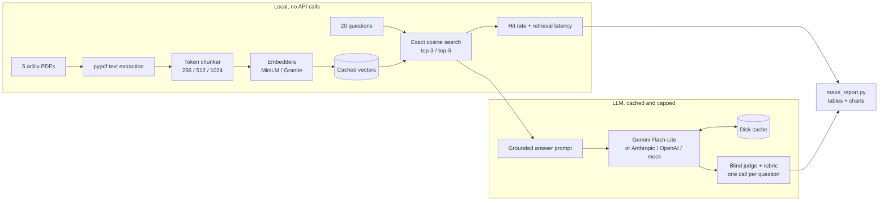
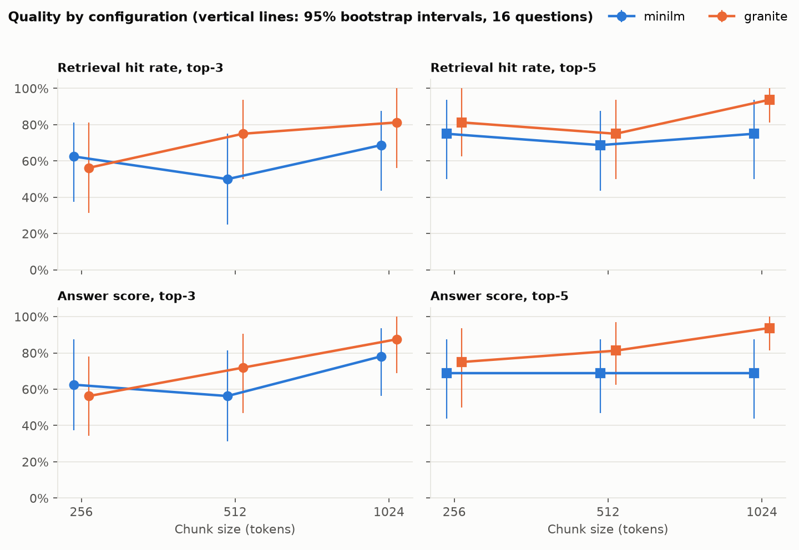
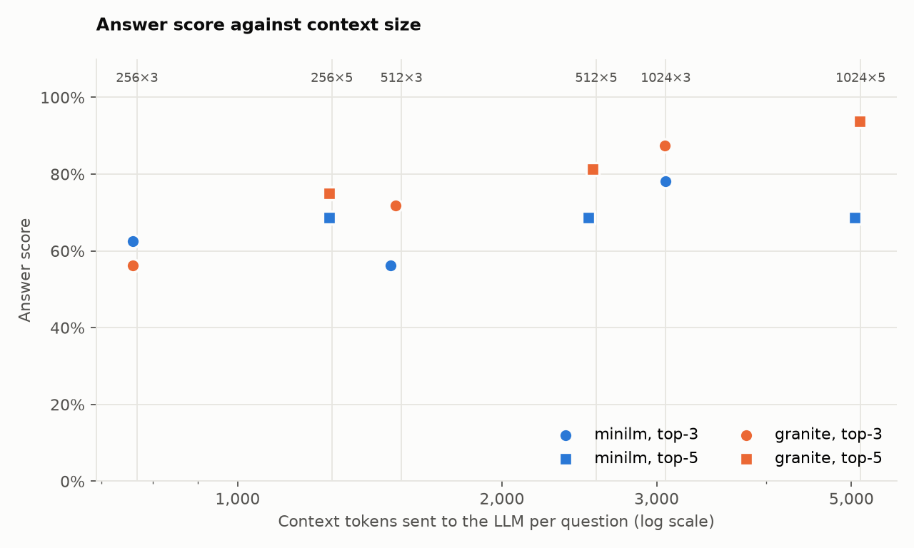
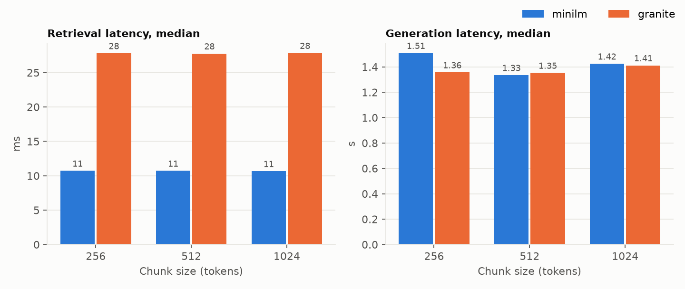

# rag-evaluation-lab

A controlled experiment that compares RAG design choices on one document set and one question set: **3 chunk sizes × 2 embedding models × 2 top-k values = 12 configurations**, scored on retrieval hit rate, answer correctness and latency.

**Main result:** long chunks with a long-context embedding model did best, at 94% answer score for 1024 tokens, Granite and top-5. Pairing long chunks with a short-context embedder wastes them, because MiniLM never reads 73% of a 1024-token chunk. With only 16 answerable questions, most individual gaps are within noise, and this README says which ones are.

## Problem

RAG systems are usually built on default settings: a chunk size from a tutorial, a popular embedding model and a top-k of 5. Those choices decide what the model sees, but teams rarely test them. This lab replaces guesswork with a repeatable comparison that reports its own uncertainty.

## Approach

**Documents:** 5 open-access arXiv papers (Transformer, Adam, Batch Normalization, ResNet, WaveNet), 68 pages in total.

**Questions:** 20 hand-written questions in [eval/questions.json](eval/questions.json).
- 12 single-fact questions and 4 that need more than one passage.
- 4 unanswerable questions, including a near miss: the batch size used for WaveNet, which the paper never states.

| Factor | Levels |
|---|---|
| Chunk size | 256, 512, 1024 tokens |
| Embedding model | `all-MiniLM-L6-v2` (reads 256 tokens), `granite-embedding-small-english-r2` (reads 8,192 tokens) |
| Top-k | 3, 5 |

**Held constant:** 15% chunk overlap, the prompt, passage order, the LLM (`gemini-3.5-flash-lite`, temperature 0) and exact cosine search in NumPy. One tokenizer measures all chunks, so both embedders see identical text.

**Metrics:**
- **Hit rate:** every required piece of evidence appears in a retrieved chunk, matched on verbatim snippets. This is stricter than matching a page.
- **Answer score:** an LLM judge gives 0, 1 or 2 against a [written rubric](eval/rubric.md), rescaled to 0–100%. The judge never sees which configuration produced an answer. Exact refusals are scored by rule.
- **Latency:** retrieval is timed locally in 7 shuffled rounds. Generation is the measured time of the original API call.
- **Uncertainty:** 95% bootstrap intervals over questions, and paired comparisons between options.

## Architecture



## Results

Real results from `gemini-3.5-flash-lite`, sorted by answer score. Hit rate and answer score use the 16 answerable questions, and brackets show the 95% interval.

| Chunk | Embedder | k | Hit rate | Answer score | Fully correct | False refusals | Correct declines | Context tokens | Retrieval p50 | Generation p50 |
|---|---|---|---|---|---|---|---|---|---|---|
| 1024 | granite | 5 | 94% | 94% (81%–100%) | 94% | 1/16 | 4/4 | 5,110 | 28 ms | 1.46 s |
| 1024 | granite | 3 | 81% | 88% (69%–100%) | 88% | 2/16 | 4/4 | 3,065 | 28 ms | 1.36 s |
| 512 | granite | 5 | 75% | 81% (62%–97%) | 75% | 2/16 | 4/4 | 2,537 | 28 ms | 1.40 s |
| 1024 | minilm | 3 | 69% | 78% (56%–94%) | 75% | 3/16 | 4/4 | 3,072 | 11 ms | 1.37 s |
| 256 | granite | 5 | 81% | 75% (50%–94%) | 75% | 4/16 | 4/4 | 1,271 | 28 ms | 1.32 s |
| 512 | granite | 3 | 75% | 72% (47%–91%) | 69% | 4/16 | 4/4 | 1,513 | 28 ms | 1.30 s |
| 256 | minilm | 5 | 75% | 69% (44%–88%) | 69% | 5/16 | 4/4 | 1,271 | 11 ms | 1.40 s |
| 1024 | minilm | 5 | 75% | 69% (44%–88%) | 69% | 5/16 | 4/4 | 5,044 | 11 ms | 1.48 s |
| 512 | minilm | 5 | 69% | 69% (47%–88%) | 62% | 4/16 | 4/4 | 2,507 | 11 ms | 1.34 s |
| 256 | minilm | 3 | 62% | 62% (38%–88%) | 62% | 6/16 | 4/4 | 759 | 11 ms | 1.62 s |
| 256 | granite | 3 | 56% | 56% (34%–78%) | 50% | 6/16 | 4/4 | 759 | 28 ms | 1.39 s |
| 512 | minilm | 3 | 50% | 56% (31%–81%) | 56% | 7/16 | 4/4 | 1,493 | 11 ms | 1.33 s |







### Which differences are real?

Each row averages over the other two factors. An interval that includes 0 means this data cannot separate the options.

| Comparison | Hit rate change (95% interval) | Answer score change (95% interval) |
|---|---|---|
| Top-5 vs top-3 | **+12.5 pts (+5 to +21), separated** | +7 pts (−2 to +17) |
| 1024 vs 256 tokens | +11 pts (−8 to +30) | +16 pts (−2 to +35) |
| 1024 vs 512 tokens | +12.5 pts (−5 to +30) | +12.5 pts (−2 to +28) |
| 512 vs 256 tokens | −2 pts (−17 to +12) | +4 pts (−12 to +19) |
| Granite vs MiniLM | +10 pts (−10 to +29) | +10 pts (−10 to +29) |

Only the top-k effect on hit rate clears its interval. The other results point in a consistent direction, but they are evidence rather than proof.

### Analysis

**1. The two "long chunk" choices work together.** Granite's lead is 0 points at 256 tokens, then 14 at 512 and 17 at 1024. That pattern fits the truncation numbers below, though each gap is still within noise on its own. MiniLM can only embed the start of a long chunk, so a passage late in the chunk is invisible to search.

| Chunk size | Text MiniLM never reads | Text Granite never reads |
|---|---|---|
| 256 | 1% | 0% |
| 512 | 49% | 0% |
| 1024 | 73% | 0% |

**2. The system fails by refusing, not by inventing.** Across 192 answerable question-configuration pairs, 49 were refusals and they account for every score of 0. Of the 143 real answers, 135 were fully correct, 8 were partial and none were entirely wrong. All 48 unanswerable cases were correctly declined.

**3. Retrieval decides the outcome.** Answers were fully correct 93% of the time after a hit (129/138) and 11% after a miss (6/54). In this setup, improving retrieval matters more than improving generation.

**4. Small chunks struggle with multi-passage questions.** These scored 47% at 256 tokens, against 84% at 512 and 78% at 1024. This rests on only 4 questions, so treat it as a lead.

**5. Bigger context barely changed generation latency.** Median generation stayed between 1.30 and 1.62 s, even with about 6× more input tokens (935 to 5,853). The cost difference is real, but users would not notice a speed difference at this scale.

**6. Retrieval speed is not a deciding factor.** Granite takes 28 ms against MiniLM's 11 ms, which is small next to about 1.4 s of generation. Indexing is the larger gap, at about 55–62 s against 5–24 s per chunk size on an 8-core CPU.

**Failure examples:**
- **q05:** one configuration retrieved AdaMax's defaults instead of Adam's and answered α = 0.002. The two passages are almost identical, and the judge gave it partial credit.
- **q12:** retrieval found the evidence in all 12 configurations, yet the model still refused 5 times. This over-caution comes from the prompt or model, so retrieval tuning cannot fix it.

### Recommendations

For a corpus like this one:

1. **Start with 1024-token chunks, Granite and top-5** when accuracy matters most.
2. **Use top-3 to cut cost.** It scored 88% with about 40% fewer input tokens, and the data cannot separate it from top-5.
3. **Don't exceed your embedder's limit.** Check `max_seq_length` before choosing a chunk size. If you must stay on MiniLM, 256-token chunks at least get fully read.
4. **Prefer top-5 unless context cost is a problem.** It is the one change with a separated effect on hit rate.
5. **Look at refusals next.** Reranking or a softer refusal prompt would target the largest failure type, and the q12 case suggests some gain is available without touching retrieval.

Repeat the experiment on your own documents and questions before adopting these settings. The ranking may change with the corpus.

### Judge audit

A judge is itself something to test, so I compared it with deterministic fact matching on the 108 distinct judged answers. They agreed on **94.4%** (102/108). I read all 6 disagreements by hand: 5 favoured the judge's decision, such as accepting "co-variate" or valid paraphrases that string matching missed, and 1 was debatable. See [results/judge_disagreements.csv](results/judge_disagreements.csv). Agreements were not hand-checked.

### Corrections made during the experiment

All of these were found by reviewing results and are recorded here because they changed the numbers:
- **Evidence labels:** my first snippets were too narrow. q09 scored 0% although correct passages were being retrieved. I then listed all qualifying passages across the whole corpus for six questions, before any API calls were made.
- **Judge references:** q06 and q10 demanded detail the questions never asked for, so correct short answers lost marks. I tightened both and re-judged them with 2 extra calls.
- **Embedding precision:** Granite loaded in bfloat16 by default, which slowed it on CPU. All embeddings were rebuilt in float32.
- **Latency method:** timing configurations one after another picked up background noise, so timing now runs in shuffled rounds.

### API usage

**251 API calls in total:** 233 generation, 16 judge and 2 re-judge. That is well below the 480 first estimated:
- Grading every answer to a question in one call cut judging from 240 calls to 16.
- 7 duplicate prompts were sent only once.
- Refusals were scored without the judge.

Generation sent about 0.66M input tokens and received about 8,000 output tokens.

## How to run

Requires Python 3.12.

```bash
python -m venv .venv
.venv\Scripts\activate             # macOS/Linux: source .venv/bin/activate
pip install -r requirements.txt
python scripts/download_papers.py

# No API calls, no key needed. Fake LLM and judge; output goes to results/mock/
python run_experiment.py --mock
python make_report.py --mock

pytest -q
```

To run with a real LLM, copy `.env.example` to `.env` and add a key. The commands below make API calls, so check the plan first.

```bash
python run_experiment.py --stage retrieval   # local only, prints how many calls would be made
python run_experiment.py --stage all         # cached, throttled, capped at MAX_API_CALLS
python make_report.py
```

The cache is not committed, so a fresh clone repeats the full ~250 calls. Set `LLM_PROVIDER` to `anthropic` or `openai` to change provider. Changing the provider or model means new calls, and the call counter in `.cache/llm/usage.json` persists across runs.

## Limitations

- **Small sample:** 16 answerable questions means one question moves a score by about 6 points. The multi-passage analysis has only 4 questions.
- **Multiple comparisons:** intervals are not adjusted for testing several comparisons, so even the separated effect deserves some caution.
- **Narrow corpus:** 5 machine learning papers with heavy maths and tables. Results may differ for contracts, manuals or support tickets.
- **One LLM, one run:** temperature 0 does not guarantee identical output, and each prompt was sent once, so generation latency has one sample per prompt.
- **Linked factors:** chunk size and top-k also set the context size, so these results can't fully separate "better chunks" from "more text".
- **Model comparison includes truncation:** MiniLM and Granite differ in more than context length, so the embedder effect is not purely about truncation.
- **Judge:** the judge is the same model as the generator, and it grades a question's answers together. Only disagreements with fact matching were hand-reviewed.
- **Evidence labels:** 6 answers were fully correct despite a retrieval miss, so the labels may still omit some valid passages, and hit rates may be slightly low. Labels were revised after seeing early retrieval output, though the search covered the whole corpus.
- **Not tested:** rerankers, hybrid search, other overlap values or semantic chunking.
- **Latency:** measured on one 8-core CPU with no GPU. Network conditions affect generation times.

## Repository layout

```
eval/          questions.json, rubric.md
scripts/       download_papers.py
src/raglab/    loader, chunker, embedder, retriever, prompts, llm, judge, metrics, config
tests/         unit tests (no network)
results/       per-question CSVs, summary tables, charts
run_experiment.py, make_report.py
```

See [LEARNING.md](LEARNING.md) for a plain-language walkthrough of the concepts and decisions.
